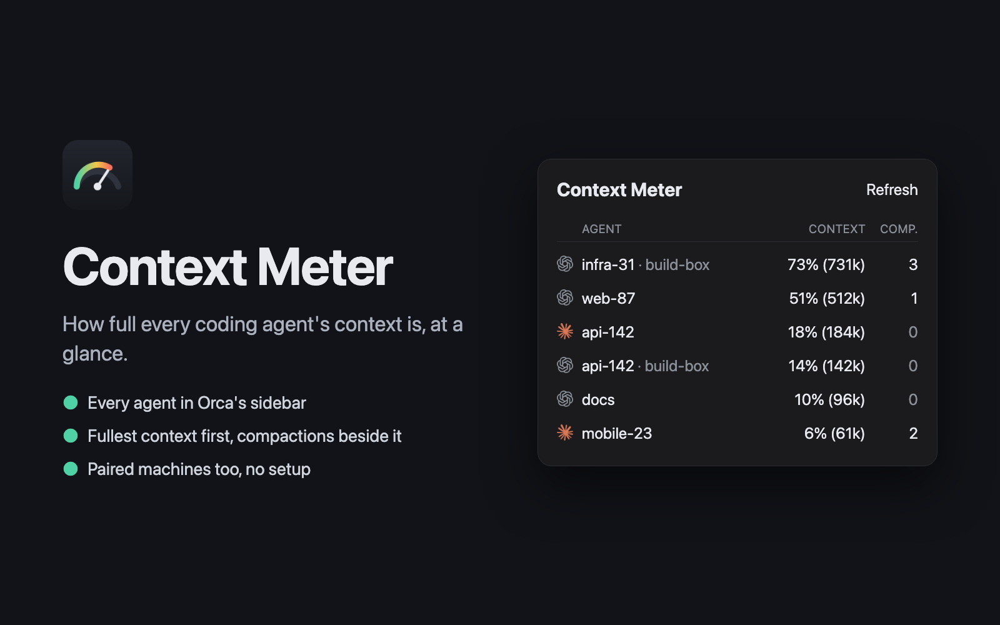

# Context Meter

[](https://github.com/Ellebam/orca-context-meter/actions/workflows/validate.yml)
[](LICENSE)
[](https://onorca.dev)



An [Orca](https://onorca.dev) plugin that shows how full each coding agent's context is, at a glance.

- **One row per agent in Orca's sidebar.** Every live Claude Code and Codex agent, idle ones included, on this
  machine and on every Orca you have paired. Closed and sleeping agents, subagents and review threads stay out.
  Each row carries its tool's logo and Orca's workspace name up to the first number, so `api-142-rate-limits`
  reads `api-142`.
- **Fullest first.** Context as a share of the window, with the token count in brackets, `51% (512k)`. On a
  tie, more compactions come first.
- **Compactions beside it.** An agent that keeps compacting stands out.
- **Always in view.** The status bar shows the three fullest agents, such as `73% infra-31`, each yellow from
  70% and red from 90%. Hover one for its details, click to show or hide the right sidebar with the full list.
- **No setup.** Nothing to configure, nothing installed on other machines.

It only reads. It counts no tokens (Orca's usage view already does) and stores nothing. While the plugin is
enabled it reads once a minute for the status bar, and only appended log lines after the first read.

## Get started

Requires Orca 1.4.248 or later.

1. **Install.** Search for **Context Meter** in Orca's community plugins, or run

   ```sh
   orca plugin install Ellebam/orca-context-meter
   ```

   Or in Orca, go to Settings → Plugins → **Add plugin** → **From a Git URL…**, paste

   ```text
   https://github.com/Ellebam/orca-context-meter
   ```

   and press **Continue**. Orca takes the latest version tag. Press **Install**, then enable it and approve its
   access (see [Permissions](#permissions)).
2. **Look at the status bar**, or open the panel in the right sidebar for the full list. Both refresh every
   minute.

### Paired machines

Agents of every Orca you have paired with this one show in the same list, named by the pairing, from
Orca itself. Their figures come over SSH: the plugin runs `ssh <pairing name>` with your own SSH configuration
and sends its reader on standard input, so nothing is installed there. That works when:

- your SSH configuration has a `Host` entry with the pairing's name,
- that host's key is already in your known hosts,
- login needs no prompt. The plugin's worker does not see your SSH agent, so name an `IdentityFile` without a
  passphrase, or the `IdentityAgent` of your key manager, in that `Host` entry,
- the machine has Node.js 20 or later.

Otherwise its agents still show, with `–` for their figures and the reason above the list.

## Where the figures come from

The plugin asks Orca for its sidebar (`orca worktree ps`, `orca-ide` on Linux, and `--environment` for each
pairing) and reads, for each agent, the newest main session log of that tool in that worktree. If Orca cannot
answer, the panel says so and shows the last 24 hours instead. From the logs it keeps only numbers, names and times. Message text never leaves
the parser.

| Client | Logs | Context | Compactions |
|---|---|---|---|
| Claude Code | `~/.claude/projects/*/*.jsonl` | input, cache read and cache creation tokens of the latest main-chain request. After a compaction, its `postTokens` until the next request. The logs do not record the window, so it follows Orca's own rule: a `[1m]` or bare first-party `claude-` model runs 1M, a gateway model 200k, and a context past 200k is 1M | `compact_boundary` records, with their trigger |
| Codex | `~/.codex/sessions/**/rollout-*.jsonl` | `total_tokens` of the latest `token_count` event against `model_context_window` | `compacted` records |

Subagent records never count toward their parent, and each Codex subagent log gets its own row. A value the log
does not state stays unknown, never zero.

## From a terminal

The same reader runs without Orca, for scripts and agents:

```sh
node src/reader.mjs --json --live                    # the agents in this machine's Orca sidebar
node src/reader.mjs --json --since 604800            # every session of the last 7 days
node src/reader.mjs --json --live --host build-box   # another machine, over your SSH configuration
```

It prints one JSON document with `"schema": 1`, a `sessions` list and, for a remote host, `available` with a
`reason` when it could not answer.

## Permissions

- **Runs its own code in a separate Node.js process** with your user account's access, to read the agent logs,
  ask Orca's command line for its sidebar and run `ssh`. It asks for nothing else.

## Develop

```sh
orca plugin validate .
orca plugin test .            # the reader on the sample logs in test-data/, and the panel
orca plugin check .           # renders the panel from the invented sessions in src/panel.check.ts
orca plugin dev watch .       # loads this folder into Orca and reloads on save
```

## License

[MIT](LICENSE)
